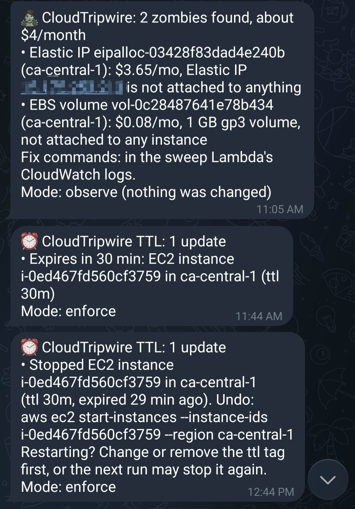
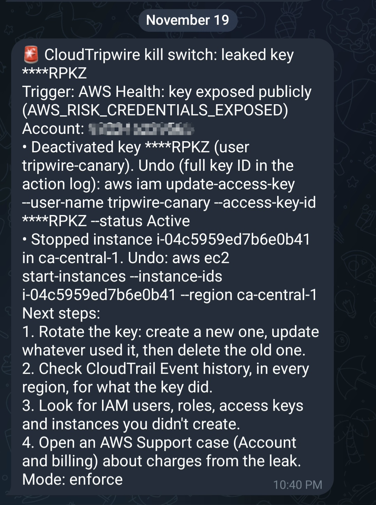
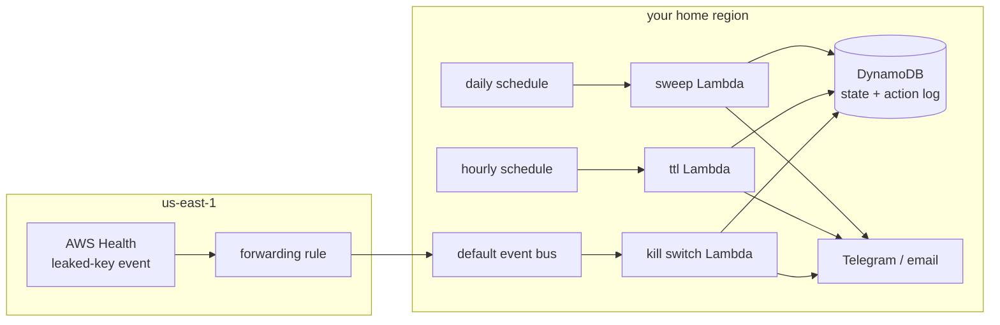

# CloudTripwire


Catch the AWS mistakes that turn into surprise bills, from inside your own account.

## Why I built this

While studying for AWS certs I kept running into the same two stories on r/aws and r/AWSCertifications.

Someone follows a tutorial, deletes the EC2 instance at the end, and forgets the NAT gateway. It bills $32 a month until the invoice shows up. Or someone pushes an access key to GitHub by accident, and within minutes there are crypto miners running in regions they have never opened.

AWS Budgets tells you about this after the money is already spent. I wanted something that finds the cause, deals with it, and runs in my own account so nobody else ever gets my credentials. It also had to be something I'd trust enough to leave switched on.

## What it does

One Terraform module, three Lambdas:

- The **sweep** runs once a day across every enabled region and finds resources that are still billing for nothing: unattached volumes, idle Elastic IPs and NAT gateways, empty load balancers, old snapshots, instances stopped for weeks. It sends a digest with what each one costs per month. It only reports.
- The **TTL timer** checks every hour for EC2 and RDS instances tagged `ttl=4h` (or `30m`, `2d`, a date). It warns you an hour before, then stops the instance when time is up.
- The **kill switch** listens for AWS's own "your key was exposed publicly" alert. When it fires, it deactivates the key, stops anything launched in the last hour, and tells you exactly what it did and how to undo it.

These are real alerts from my test account:





## How it works



AWS only sends leaked-key events to us-east-1, wherever you deploy. So the module puts two small forwarding rules there and keeps everything else in the region you choose. More detail in [docs/architecture.md](docs/architecture.md).

## Try it

You need Terraform 1.5+, the AWS CLI signed in to the account you want to protect, and a Telegram bot or an email address.

```hcl
provider "aws" {
  region = "ca-central-1" # your home region
}

provider "aws" {
  alias  = "us_east_1" # where AWS sends leaked-key events
  region = "us-east-1"
}

module "cloudtripwire" {
  source = "github.com/dev-95/cloudtripwire//terraform?ref=v0.1.0"
  providers = {
    aws           = aws
    aws.us_east_1 = aws.us_east_1
  }

  channels    = ["telegram", "email"]
  alert_email = "you@example.com"
}

output "ssm_setup_commands" {
  value = module.cloudtripwire.ssm_setup_commands
}
```

Run `terraform init` and `terraform apply`, confirm the subscription email, then run the commands from the `ssm_setup_commands` output to store your Telegram token and chat ID in SSM. Full setup, every variable and how to uninstall: [docs/configuration.md](docs/configuration.md).

## Decisions I made on purpose

**It stops things. It never deletes them.** A "zombie" volume might be the only copy of someone's data. CloudTripwire stops instances and deactivates keys, and every action comes with a one-line undo command. Deleting is your call; the sweep only suggests the command. ([ADR 0001](docs/decisions/0001-stop-not-delete.md))

**TTL starts in observe mode, the kill switch doesn't.** TTL only reports "would stop" until you switch it to `enforce`. The kill switch acts by default, because a leaked key gets abused faster than anyone can read an alert, and everything it does can be reversed. You can set it to observe if you'd rather decide yourself. ([ADR 0002](docs/decisions/0002-killswitch-enforce-default.md))

**You can opt anything out.** Tag a resource `tripwire=ignore` and it's never flagged or touched. The IAM policies enforce that too, so a bug in my code still can't stop it.

**Every permission is written down.** Each Lambda has its own role, there are no wildcard actions, and CI fails if a `Delete`, `Terminate` or `Release` action ever appears. Each permission and the reason for it is in [docs/permissions.md](docs/permissions.md).

## What broke along the way

The first deploy failed to send a single Telegram message, four different ways. Two of them came from the same thing: pasting the bot token and chat ID into PowerShell kept the quotes around them, and SSM stored them as part of the value. The setup commands now strip them, and failed sends log Telegram's actual error so the next problem is obvious.

My first IAM policy included `kms:Decrypt` for the SSM secrets. I took it out and tested again on real AWS. It still worked, because the AWS-managed SSM key already allows decryption through SSM. That's one less permission to explain.

I planned to test the kill switch's cross-region routing with GuardDuty sample findings. My test account is on the AWS Free plan, which doesn't allow GuardDuty. So I proved the path with a temporary custom event sent from us-east-1, watched it arrive in ca-central-1 with its source intact, and deleted the test rules afterwards. Planning the GuardDuty test also made me add a guard so GuardDuty sample findings can never trigger the kill switch, since they'd otherwise stop any recently launched instance.

During the live kill switch test, the Telegram send took about 10 seconds, right at the 10-second timeout. I raised it to 15.

## How it's tested

252 unit tests with [moto](https://github.com/getmoto/moto) run on every push, along with ruff, `terraform validate`, gitleaks and the IAM guard. I also ran each feature against a real test account: seeded zombies showing up in the digest, a `ttl=30m` instance getting stopped on schedule, the kill switch deactivating a canary user's key and stopping an instance across 17 regions in 19 seconds, and the cross-region forwarding test above.

Not tested live yet: a real AWS Health leaked-key event (nobody can send those by hand), GuardDuty findings, and stopping RDS.

## Cost

It fits inside the AWS free tier at normal scale. The only paid piece is GuardDuty, which is optional; without it, the kill switch still reacts to AWS Health's leaked-key alerts, and those work on every account. Breakdown in [docs/configuration.md](docs/configuration.md#cost).

## Stop leaks before they happen

The kill switch is the last line of defence. [`guardrails/`](guardrails/) has a gitleaks pre-commit hook and a GitHub Actions workflow you can copy into your own repos so a key never gets pushed in the first place.

## How I built it

I wrote this with Claude Code as a pair programmer. The design decisions, the approval for every change to AWS, and all the live testing were mine. [CLAUDE.md](CLAUDE.md) is the spec and working log we built from, if you want to see how it came together.

## What's next

- v0.2: one-click CloudFormation install, Slack alerts, crash alarms on Telegram (today they only go to email)
- Later: the same safety net for Azure

If you install it, a star or a note in Discussions tells me someone's using it. There is no telemetry.

## Docs

[Configuration](docs/configuration.md) · [Architecture](docs/architecture.md) · [Permissions](docs/permissions.md) · [Detectors](docs/detectors.md) · [TTL rules](docs/ttl.md) · [Kill switch](docs/killswitch.md)

MIT licensed.
